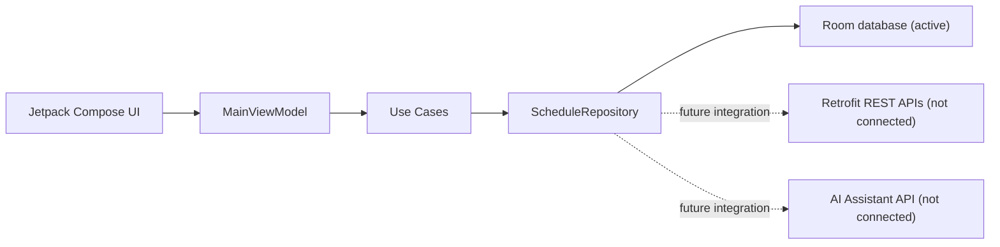

# ShiftSync

ShiftSync is a restaurant shift swapping and scheduling Android app built to demonstrate the kind of product and engineering judgment expected in a modern scheduling product. It uses Jetpack Compose, Clean Architecture, MVVM, Kotlin Flow, durable Room storage, Retrofit-ready API boundaries, and focused scheduling business rules.

## What It Does

- Weekly roster with assigned shifts, roles, sections, times, and status badges.
- Trade marketplace where coworkers can claim unassigned or teammate-posted shifts. Posting retains the original owner until a successful claim transfers the assignment.
- Clearly labeled **Demo employee** selector to exercise the two-person workflow on one device; this is local sample identity selection, not authentication. The selection resets to Maya after process restart.
- On-device persistence for claims, open-board posts, targeted requests, and their notes across app restarts; the sample schedule is seeded once.
- Swap request flow that lets staff post to the open board or target a teammate.
- Atomic ownership transfer with saved-state checks for self-claims, unavailable shifts, unknown employees, overlap, minimum rest, and weekly hour limits. Competing claims cannot overwrite a winner or jointly exceed the weekly limit.
- Successful claims accept pending open-board requests and reject superseded targeted requests in the same transaction. Request history UI and targeted-request acceptance remain future work.
- Smart Shift Assistant that drafts polite swap notes and summarizes weekly hours, coverage gaps, and wage estimates.

## Architecture



The project is organized by layer:

- `presentation`: Compose screens, dialog state, and `MainViewModel`.
- `domain`: business models, repository contract, and use cases.
- `data`: Room entities/DAO, Retrofit DTOs, offline-first repository, and seeded sample repository.

## Key Technical Decisions

- **Clean Architecture + MVVM:** scheduling rules live in use cases, keeping UI state simple and testable.
- **Repository pattern:** the UI depends on `ScheduleRepository`, so local cache, REST sync, and AI service details remain replaceable.
- **Kotlin Flow:** roster and marketplace screens update reactively as shifts are traded or claimed.
- **Durable local storage:** the app uses `OfflineFirstScheduleRepository` and a single application-scoped Room database. Initial seeding and shift/request writes are transactional. Existing data is never overwritten during startup; an empty open board stays empty. `InMemoryScheduleRepository` remains a lightweight test fixture. This is local persistence, not server sync.
- **Conflict rules in domain layer:** eligibility rules are checked by the repository inside the Room write transaction (or the fixture mutex). The UI snapshot is never the source of truth for a claim. Posting also checks the expected owner to reject stale dialogs after a transfer.

Architecture decisions are documented in [docs/adr](docs/adr), starting with the offline-first scheduling boundary.

## AI Workflow Transparency

The Smart Shift Assistant boundary is intentionally explicit. In production, `AssistantApi` can point at OpenAI, Gemini, or an internal scheduling service. In this sample, the repository returns deterministic AI-style text so the app remains demoable without secrets.

Codex assisted with triage, persistence wiring, transaction/error handling, tests, and documentation. Build/test claims below are grounded in actual CI results; device verification is reported separately.

## Testing

Included tests:

- `ValidateTradeEligibilityUseCaseTest`: overlapping shifts, max-hour violations, and valid claims.
- `RequestShiftSwapUseCaseTest`: smart-note path and open-board posting.
- `CalculateWeeklyScheduleMetricsUseCaseTest`: weekly hours, dinner shift count, and estimated earnings.
- `SwapRequestDialogTest`: Compose dialog opens, accepts input, and submits the smart-note action (device instrumentation).
- `PersistentScheduleRepositoryTest`: real file-backed Room database under Robolectric; reopen durability, seeding, transaction rollback, posted-shift transfers and request resolution, stale ownership, rejected claims, competing claims, concurrent weekly limits, rest checks, reactive queries, and stored wage rates.
- `ClaimOwnershipFlowTest`: two employees posting/claiming through ViewModels, roster and insight refreshes, local employee switching, and duplicate-tap protection.
- `ScheduleStorageStateTest`: startup retry and save-error behavior through ViewModel state.

Run from the project root with JDK 17, Gradle 8.9, and Android SDK 35 installed (there is currently no Gradle wrapper):

```bash
bash scripts/validate-project.sh
gradle assembleDebug testDebugUnitTest assembleDebugAndroidTest
# Requires a connected Android device or emulator:
gradle connectedDebugAndroidTest
```

CI builds the debug APK, runs JVM tests, and compiles instrumentation tests. Project validation alone checks structure and documentation; it does not execute Kotlin tests. `CoverageInsightFlowTest` checks seeded repository → use cases → ViewModel state after claiming and posting open shifts. Instrumentation execution requires a device and is not part of the hosted CI job.

## Live status

Not live yet — blocked by release preparation and distribution. There is no verified public app listing or live URL. This is a Kotlin/Android demo, not a hosted website. It seeds restaurant sample data into a local Room database once. Claims and requests persist across restarts; sample dates are not rolled forward automatically. Uninstalling or clearing app storage resets local data. Retrofit boundaries are not connected; there is no authentication, multi-device sync, or production backend. The assistant uses deterministic local text rather than a live AI service. No API key is required for the current app.

## Demo Entry Point

`ShiftSyncApplication` owns `shiftsync.db` and the persistent repository. `MainActivity` wires it into the ViewModel; startup seeds the database on a background Room transaction before observing it. Loading failures offer Retry, and failed writes retain the swap input and show an error.

To exercise ownership: as Maya, post a roster shift to the open board. It remains in Maya’s roster; Marketplace identifies the owner and disables self-claim. Use **Demo employee** to select Sam, claim the posted shift, then switch back to Maya. The shift should be removed from Maya’s roster and added to Sam’s, with updated hours and coverage gaps. Force-stop and relaunch to check durability (the demo employee selection resets to Maya). Conflicting or stale claims show an error and keep the current owner. Employee switching and repeated claim taps are disabled during a write. Rotation uses the same application database and ViewModel. UI taps and real-device lifecycle behavior still require device verification; Robolectric database tests are JVM tests, not a device test pass.

For a reviewer-facing walkthrough, use [docs/demo-checklist.md](docs/demo-checklist.md).
