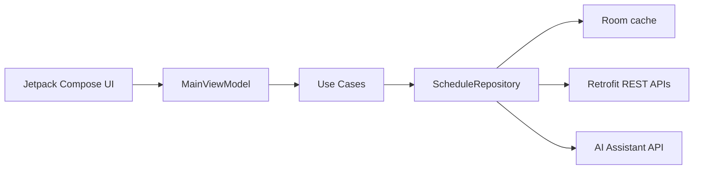

# ShiftSync

ShiftSync is a restaurant shift swapping and scheduling Android app built to demonstrate the kind of product and engineering judgment expected in a modern scheduling product. It uses Jetpack Compose, Clean Architecture, MVVM, Kotlin Flow, Room-ready offline caching, Retrofit-ready API boundaries, and focused scheduling business rules.

## What It Does

- Weekly roster with assigned shifts, roles, sections, times, and status badges.
- Trade marketplace where coworkers can claim open shifts.
- Swap request flow that lets staff post to the open board or target a teammate.
- Conflict prevention for overlapping shifts and max weekly hour limits.
- Smart Shift Assistant that drafts polite swap notes and summarizes weekly hours, coverage gaps, and wage estimates.

## Architecture



The project is organized by layer:

- `presentation`: Compose screens, dialog state, and `MainViewModel`.
- `domain`: business models, repository contract, and use cases.
- `data`: Room entities/DAO, Retrofit DTOs, offline-first repository, and seeded sample repository.

## Key Technical Decisions

- **Clean Architecture + MVVM:** scheduling rules live in use cases, keeping UI state simple and testable.
- **Repository pattern:** the UI depends on `ScheduleRepository`, so local cache, REST sync, and AI service details remain replaceable.
- **Kotlin Flow:** roster and marketplace screens update reactively as shifts are traded or claimed.
- **Room models included:** the sample app runs with `InMemoryScheduleRepository`, while `OfflineFirstScheduleRepository` shows the production path for instant cached schedules.
- **Conflict rules in domain layer:** overlapping shifts and weekly hour limits are testable without Android dependencies.

## AI Workflow Transparency

The Smart Shift Assistant boundary is intentionally explicit. In production, `AssistantApi` can point at OpenAI, Gemini, or an internal scheduling service. In this sample, the repository returns deterministic AI-style text so the app remains demoable without secrets.

AI was useful for drafting mock data, README structure, and test boilerplate. The core domain model, repository boundaries, Compose state flow, and scheduling rules were designed manually around restaurant shift-swapping requirements.

## Testing

Included tests:

- `ValidateTradeEligibilityUseCaseTest`: overlapping shifts, max-hour violations, and valid claims.
- `RequestShiftSwapUseCaseTest`: smart-note path and open-board posting.
- `SwapRequestDialogTest`: Compose dialog opens, accepts input, and submits the smart-note action.

Run locally from the project root after installing Android Gradle tooling:

```bash
./gradlew test
./gradlew connectedAndroidTest
```

If a Gradle wrapper has not been generated yet, open the project in Android Studio and let it sync, or run `gradle wrapper` with a local Gradle install.

## Demo Entry Point

`MainActivity` wires an in-memory repository with seeded restaurant data so the app launches directly into the usable ShiftSync experience.
